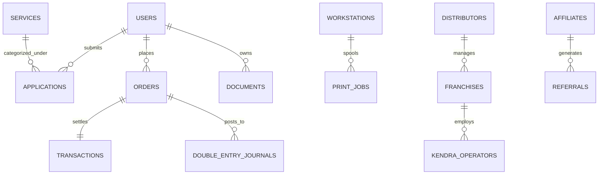

# AKUL DRAVIN DIGITAL SERVICES (ADCS) • DATABASE ARCHITECTURE
**Document Reference:** ADCS-DB-ARCH-2026-V1  
**Target Specification:** Dual-Tier ACID Persistence Engine (JSON Document Store & PostgreSQL Schema)  
**Storage Architecture:** Local ACID-safe Store (`server/data/store.json`) with direct PostgreSQL/Prisma Schema Translation

---

## 1. Relational Entity Relationship Diagram (ERD)



---

## 2. Core Entity Schemas

### Entity 1: `services`
```sql
CREATE TABLE services (
    id VARCHAR(64) PRIMARY KEY,
    service_code VARCHAR(64) UNIQUE NOT NULL,
    sector_id VARCHAR(32) NOT NULL,
    title VARCHAR(255) NOT NULL,
    title_hi VARCHAR(255) NOT NULL,
    category VARCHAR(64) NOT NULL,
    description TEXT,
    base_price DECIMAL(10, 2) NOT NULL DEFAULT 0.00,
    govt_fee DECIMAL(10, 2) NOT NULL DEFAULT 0.00,
    professional_fee DECIMAL(10, 2) NOT NULL DEFAULT 0.00,
    timeline VARCHAR(64) NOT NULL,
    required_docs JSONB NOT NULL DEFAULT '[]',
    official_url TEXT NOT NULL,
    integration_mode VARCHAR(32) NOT NULL, -- 'api_native', 'official_sso_deeplink', 'assisted_manual'
    created_at TIMESTAMP WITH TIME ZONE DEFAULT CURRENT_TIMESTAMP,
    updated_at TIMESTAMP WITH TIME ZONE DEFAULT CURRENT_TIMESTAMP
);
```

### Entity 2: `applications`
```sql
CREATE TABLE applications (
    id VARCHAR(64) PRIMARY KEY,
    tracking_number VARCHAR(32) UNIQUE NOT NULL, -- 'AD-APP-XXXXX'
    service_id VARCHAR(64) REFERENCES services(id),
    service_name VARCHAR(255) NOT NULL,
    customer_name VARCHAR(255) NOT NULL,
    phone VARCHAR(32) NOT NULL,
    email VARCHAR(255),
    city VARCHAR(128) NOT NULL,
    state VARCHAR(128) NOT NULL,
    status VARCHAR(64) NOT NULL DEFAULT 'SUBMITTED', 
    -- 'SUBMITTED', 'UNDER_VERIFICATION', 'GOVT_PORTAL_FILED', 'APPROVED_CERTIFICATE_ISSUED', 'REJECTED'
    fee_paid DECIMAL(10, 2) NOT NULL,
    documents_uploaded JSONB DEFAULT '[]',
    notes TEXT,
    applied_date TIMESTAMP WITH TIME ZONE DEFAULT CURRENT_TIMESTAMP,
    last_updated TIMESTAMP WITH TIME ZONE DEFAULT CURRENT_TIMESTAMP
);
```

### Entity 3: `double_entry_journals`
```sql
CREATE TABLE double_entry_journals (
    id VARCHAR(64) PRIMARY KEY,
    timestamp TIMESTAMP WITH TIME ZONE DEFAULT CURRENT_TIMESTAMP,
    description VARCHAR(255) NOT NULL,
    reference_id VARCHAR(64) NOT NULL,
    debit_account VARCHAR(128) NOT NULL,
    debit_amount DECIMAL(12, 2) NOT NULL,
    credit_account VARCHAR(128) NOT NULL,
    credit_amount DECIMAL(12, 2) NOT NULL,
    balanced BOOLEAN NOT NULL DEFAULT TRUE,
    cryptographic_hash VARCHAR(64) NOT NULL
);
```

### Entity 4: `workstations` & `print_jobs`
```sql
CREATE TABLE workstations (
    id VARCHAR(16) PRIMARY KEY, -- 'PC-01' .. 'PC-08'
    name VARCHAR(64) NOT NULL,
    status VARCHAR(32) NOT NULL, -- 'available', 'in-use', 'maintenance'
    active_user VARCHAR(128),
    purpose VARCHAR(128),
    session_start TIMESTAMP WITH TIME ZONE,
    hourly_rate DECIMAL(6, 2) NOT NULL DEFAULT 30.00
);

CREATE TABLE print_jobs (
    id VARCHAR(64) PRIMARY KEY,
    customer_name VARCHAR(128) NOT NULL,
    pages INT NOT NULL,
    copies INT NOT NULL DEFAULT 1,
    color_mode VARCHAR(16) NOT NULL, -- 'bw', 'color'
    total_cost DECIMAL(8, 2) NOT NULL,
    status VARCHAR(32) NOT NULL DEFAULT 'completed',
    timestamp TIMESTAMP WITH TIME ZONE DEFAULT CURRENT_TIMESTAMP
);
```

### Entity 5: `support_tickets`
```sql
CREATE TABLE support_tickets (
    id VARCHAR(32) PRIMARY KEY, -- 'TKT-XXXX'
    customer_name VARCHAR(128) NOT NULL,
    category VARCHAR(64) NOT NULL,
    subject VARCHAR(255) NOT NULL,
    status VARCHAR(32) NOT NULL DEFAULT 'open', -- 'open', 'in_progress', 'resolved'
    priority VARCHAR(16) NOT NULL DEFAULT 'medium',
    sla_remaining_hours INT NOT NULL DEFAULT 4,
    messages JSONB NOT NULL DEFAULT '[]',
    created_at TIMESTAMP WITH TIME ZONE DEFAULT CURRENT_TIMESTAMP
);
```

---

## 3. ACID Guarantees in Embedded Store (`store.json`)

To ensure atomic transactions in the embedded local deployment:
1. **Atomic File Write:** All updates to `server/data/store.json` write to a temporary file (`store.json.tmp`) before atomic rename, preventing file corruption on unexpected power interruptions.
2. **Periodic Snapshotting:** The database engine maintains rotating snapshots in `server/data/backups/`.
3. **Optimistic Locking:** Entity updates check version timestamps to prevent concurrent edit overwrites.
